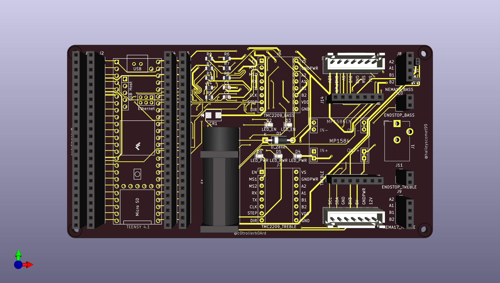
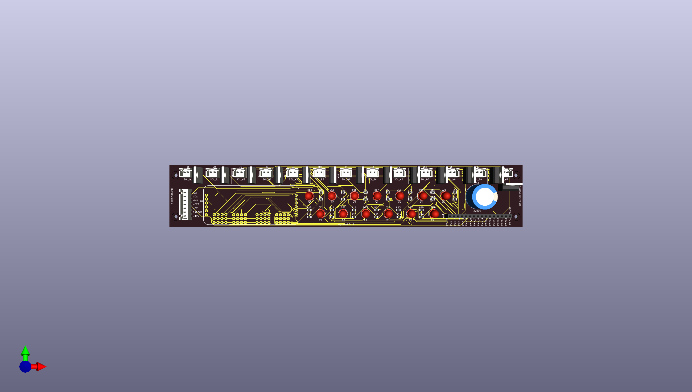

# PCB： Design

| Board | Role | Size | Qty |
|---|---|---|---|
| [**C0nTrollER**](C0nTrollER_Board/) | Main controller: Teensy 4.1, two stepper drivers, power input and protection, 5 V rail | 134.7 × 71.2 mm | 1 |
| [**PLAyeRs**](PLAyeRs_Board/) | Solenoid driver: 13 channels driven by a PCA9685 over I²C | 230.1 × 40.1 mm | 2 (Treble + Bass) |

## System Architecture

```
        12 V DC (5 A supply, barrel jack)
              │
   ┌──────────▼────────────────────────────────────────┐
   │ C0nTrollER                                        │
   │  5 A fuse → SMBJ16A TVS → PMOS reverse-polarity   │
   │  → 12 V rail (4700 µF bulk)                       │
   │  MP1584 buck → 5 V                                │
   │  Teensy 4.1 ─ STEP/DIR/EN ─► TMC2209 ×2 ─► NEMA17 ×2
   │             ◄─ ENDSTOP ×2                         │
   │             ─ I²C (SDA/SCL, 4.7 kΩ pull-ups) ─┐   │
   └───────────────────────────────────────────────┼───┘
         7-pin JST-XH (TREBLE)        7-pin JST-XH (BASS)
                 ▼                              ▼
          ┌─────────────┐                ┌─────────────┐
          │ PLAyeRs     │                │ PLAyeRs     │
          │ PCA9685 0x41│                │ PCA9685 0x40│
          │ 13× IRLZ34N │                │ 13× IRLZ34N │
          └──────┬──────┘                └──────┬──────┘
           13 solenoids                    13 solenoids
```

Both PLAyeRs boards share one I²C bus. The board with the A0 solder jumper bridged is `0x41` (Treble); the one without it is `0x40` (Bass).

### Why these parts
- **One MOSFET per key.** A solenoid needs 12 V at about 0.4 A, far more than any logic pin can supply, so each key has its own logic-level N-MOSFET (IRLZ34N) working as a low-side switch.
- **PCA9685.** It gives 16 PWM outputs over two I²C wires. One chip per player board covers all 13 keys, and the PWM can vary how hard a key is struck.
- **TMC2209.** A very quiet stepper driver, which matters because the robot sits next to a microphone. The Teensy only sends STEP / DIR / EN.
- **MP1584 buck.** Steps 12 V down to 5 V efficiently. A linear regulator would turn the difference into heat.
- **Teensy 4.1.** Fast, with plenty of pins and native USB MIDI for the music software.
- **4 layers.** The inner layers are planes: In1 = GNDPWR, In2 = +12 V. They give wide, low-resistance paths for the solenoid and motor current and keep motor noise away from the logic.
- **Double-sided placement on PLAyeRs.** It keeps the long, narrow board compact. C0nTrollER has every part on the top side.

---

## C0nTrollER Board



[Schematic PDF](C0nTrollER_Board/C0nTrollER.pdf) · [3D model](C0nTrollER_Board/C0nTrollER.step) · [Gerbers](C0nTrollER_Board/output/output.zip)

### Power path
1. 12 V barrel jack (CUI PJ-102AH; the connector is rated 5 A).
2. 5 A slow-blow fuse in a 5×20 mm holder (F1).
3. SMBJ16A TVS diode (CR1) clamps voltage spikes.
4. P-MOSFET (Q1, with gate Zener D1) blocks reverse polarity.
5. 4700 µF bulk capacitor (C1, rated 16 V or more; mind the polarity) keeps 12 V steady when the motors and solenoids switch.
6. MP1584 buck module makes 5 V for the Teensy and the PLAyeRs logic.

> **Before first power-up:** with the Teensy removed, adjust the MP1584 output to 5.0 V. Then cut the VIN–VUSB trace on the underside of the Teensy. Otherwise USB 5 V and the board's 5 V rail are tied together and fight each other.

### Teensy 4.1 pin map

| Function | Treble | Bass |
|---|---|---|
| STEP | 5 | 2 |
| DIR | 6 | 3 |
| EN (active LOW) | 7 | 4 |
| ENDSTOP (`INPUT_PULLUP`, pressed = LOW) | 10 | 8 |

I²C uses `Wire`: SDA = pin 18, SCL = pin 19. The TMC2209 UART is not used; motor current is set with each driver's Vref potentiometer.


## PLAyeRs Board



<!-- TODO: photo of the assembled board, ideally on the carriage with solenoids wired -->

[Schematic PDF](PLAyeRs_Board/PLAyeRs.pdf) · [3D model](PLAyeRs_Board/PLAyeRs.step) · [Gerbers](PLAyeRs_Board/output/output.zip)

### One solenoid channel

```
PCA9685 PWM ─ 100 Ω ─┬─ Gate ┐
                     └─ 10 kΩ ─ GNDPWR      IRLZ34N
12 V ─┬─ solenoid ───────────── Drain       Source ─ GNDPWR
      ├─ SS14 (cathode to 12 V, anode to Drain)   flyback
      └─ 680 Ω ─ LED ───────── Drain         lights while the solenoid is on
```

- The 100 Ω gate resistor limits switching current. The 10 kΩ pull-down holds the MOSFET off when the PWM pin isn't being driven.
- The SS14 diode absorbs the inductive kick when the coil switches off.
- The status LED lights when the MOSFET pulls the drain low, so every strike is visible.
- With no solenoid connected, the drain floats at about 9.8 V; this is normal. With a solenoid connected, the drain idles at about 12 V.

### Solenoid
JF-1039(B): 12 V, about 0.4 A, 10 mm stroke, 25 N at full closure. The force is much lower when the plunger is far from closed. Don't keep a solenoid energized for more than about 2 s.


### Power budget
With all 13 channels on at once, one board draws 13 × 0.4 A ≈ 5.2 A, so both boards together draw about 10 A. A 5 A supply cannot sustain that. Firmware must therefore limit how many fingers fire at the same time: a few at once, with short pulses. In normal playing, strikes last 30–150 ms.

## Manufacturing

| Parameter | Value |
|---|---|
| Layers | 4 (F.Cu / In1.Cu GNDPWR / In2.Cu +12 V / B.Cu) |
| Thickness | 1.6 mm |
| Copper | 1 oz outer (35 µm) |
| Fab | JLCPCB (upload `output/output.zip` from each board folder) |
